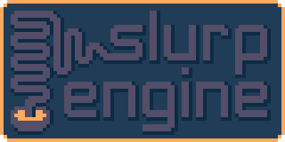
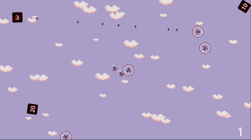

## games
[https://sebsong.itch.io/](https://sebsong.itch.io/)

## art
[https://artstation.com/sebsong](https://artstation.com/sebsong)

## projects

### löve 2d
<iframe frameborder="0" src="https://itch.io/embed/4604771?border_width=5&amp;bg_color=423952&amp;fg_color=bb474f&amp;link_color=713f52&amp;border_color=444760" width="560" height="175"><a href="https://sebsong.itch.io/deliverance">deliverance by sebsong</a></iframe>

&nbsp;

### c++
#### [slurp engine](https://github.com/sebsong/slurp-engine): custom c++ game engine

<iframe frameborder="0" src="https://itch.io/embed/4188073?border_width=5&amp;bg_color=0d2b45&amp;fg_color=ffaa5e&amp;link_color=544e68&amp;border_color=203c56" width="560" height="175"><a href="https://sebsong.itch.io/abyssal">abyssal by sebsong</a></iframe>

&nbsp;

### unreal
<iframe frameborder="0" src="https://itch.io/embed/2768649?border_width=5&amp;bg_color=6e4d7b&amp;fg_color=ffffff&amp;link_color=f2e02c&amp;border_color=715c84" width="560" height="175"><a href="https://sebsong.itch.io/crokinole-in-one">Crokinole In One by sebsong</a></iframe>

&nbsp;

### godot
#### [minions](https://github.com/sebsong/minions): prototype featuring planes with swappable components

#### [power line](https://github.com/sebsong/power_line): prototype tower defense with a powered grid of nodes
#### [ankle (and knee) rehab app](https://github.com/sebsong/ankle_rehab): app made in one sitting on a flight for some injured friends
#### [various prototypes](https://github.com/sebsong/godot-prototypes): early prototypes exploring interesting mechanics

&nbsp;

### unity
(various projects made as a student)
#### [tourist](pages/tourist/tourist.html): cute game about anagrams
#### [matte grey](pages/matte-grey/matte-grey.html): typing game
#### [spin pong](pages/spinpong/spinpong.html): pong with a twist (literally)
#### [walls in ppace](pages/walls_in_space/walls_in_space.html): space flying arcade game
#### [stairway to heaven](pages/stairway_to_heaven/stairway_to_heaven.html): half day game jam bug turned feature
#### [a land down under](pages/a_land_down_under/a_land_down_under.html): bathysphere in a procedurally generated cave system
#### [into the light](pages/into_the_light/into_the_light.html): lasers and monsters in the dark
#### [hooke](pages/hooke/hooke.html): exploring a hook shot mechanic

&nbsp;
